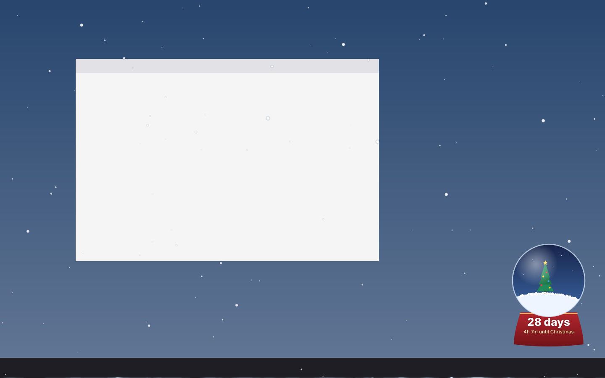
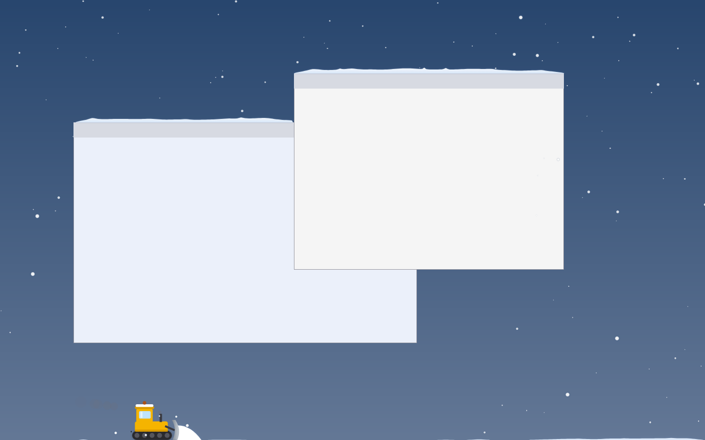
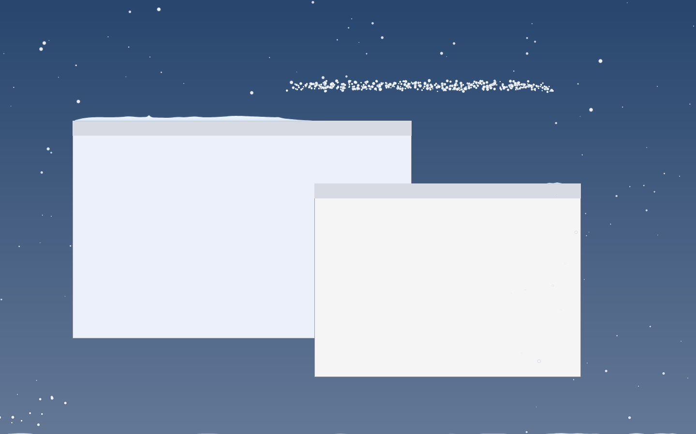
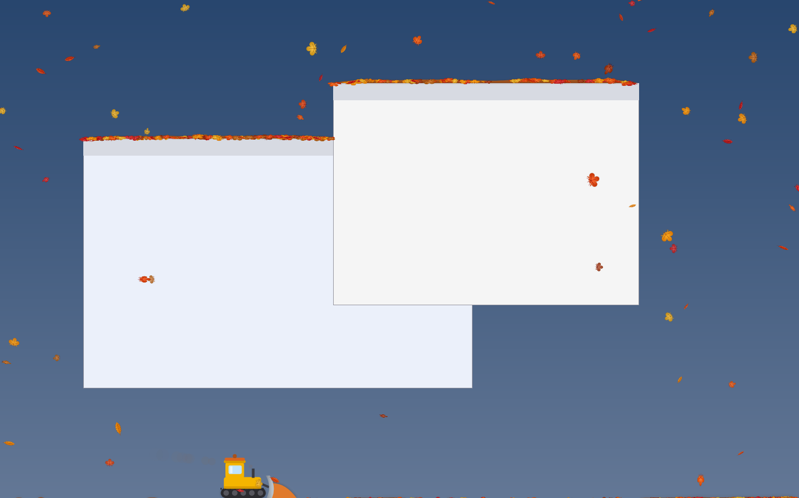
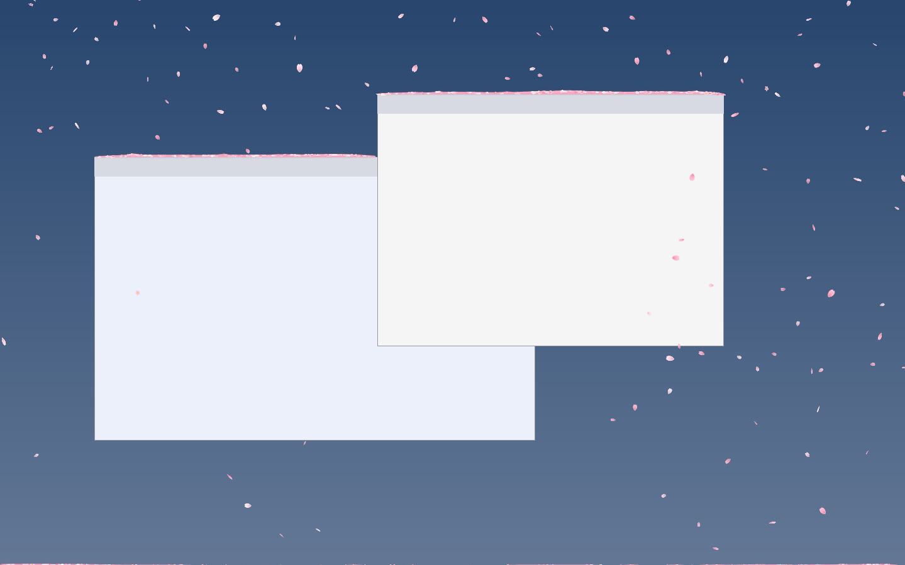

# Let It Snow ❄️

A tiny desktop app for Windows and macOS that makes snow fall gently over your screen
and shows a snow globe counting down to Christmas.



## What it does

- **Snow over everything.** A transparent, always-on-top layer on every monitor. Clicks go
  straight through it, so you can keep working.
- **Snow piles up** on top of your taskbar (Windows) or dock (Mac), and melts very slowly.
- **Three themes:** ❄️ Snow, 🍁 Autumn leaves (tumbling red, orange and gold leaves) and
  🌸 Cherry blossoms (fluttering pink petals, with the odd whole flower). Leaves and petals
  pile up too, and you can see them lying on top of the piles.
- **Snow settles on top of your open windows.** Move or close a window and the snow falls off.
  Only the parts of a window's top edge you can actually see collect snow.
- **A little bulldozer** drives along the taskbar / dock and pushes the pile off the screen.
  Send it from the menu, or let it come by on its own when the snow gets deep.
- **Snowflake icon** in the system tray / menu bar:
  - Let it snow (on/off)
  - Theme: Snow, Autumn leaves, Cherry blossoms
  - How much snow: Light flurries, Gentle snow, Heavy snow, Blizzard
  - Pile up on the taskbar / dock
  - Snow on top of windows
  - Send the bulldozer, Bulldozer clears deep snow on its own
  - Show Christmas countdown, Reset countdown position
  - Start when I log in
- **Snow globe countdown.** Shows days, hours and minutes until Christmas. Click it to shake
  the globe, drag it to move it, hover and press × to hide it.

Settings are saved between launches.

| Bulldozer | Snow falling off a moved window |
| --- | --- |
|  |  |

| Autumn leaves | Cherry blossoms |
| --- | --- |
|  |  |

## Run it

You need [Node.js](https://nodejs.org) 18 or newer.

```bash
npm install
npm start
```

Look for the snowflake in your tray (Windows, bottom right, maybe under the ^ arrow)
or menu bar (Mac, top right). There is no window or dock icon on purpose.

## Light on memory

Let It Snow is a small Electron app, tuned to stay light while it runs all day:

- Only 3 processes while snowing (app, one renderer, GPU). The countdown widget shares the
  snow's renderer, and Chromium's network service runs inside the app process.
- Window positions on Windows come from direct system calls in the app process
  (via [koffi](https://koffi.dev)), not from a separate helper process.
- The snow canvas is drawn at 1 pixel per screen point, so 4K and Retina screens don't
  need a 4x bigger buffer. Snow still runs at a smooth 60 fps.
- The animation creates no garbage while it runs (flakes are reused), so there are no
  garbage-collection hiccups and memory stays flat.
- Turn the snow and the countdown off and every window is closed: just the tray icon is left.

In a test on a 2560×1440 screen at 200% scaling, memory went from about 776 MB across
5 processes (v0.3.0) to about 486 MB across 3 processes (v0.4.0), and about 226 MB when
everything is switched off.

## Build installers

```bash
npm run dist:win   # on Windows -> dist/Let It Snow Setup.exe and a portable .exe
npm run dist:mac   # on a Mac    -> dist/Let It Snow.dmg (Intel + Apple Silicon)
```

The builds are **unsigned** for now. Windows will show a SmartScreen warning ("More info" →
"Run anyway") and macOS needs right-click → Open the first time. To sell it, add code
signing: an Apple Developer ID ($99/year, plus notarization) and a Windows code signing
certificate.

## Developing

Two environment variables help when testing on a machine without real windows:

```bash
SNOW_FAKE_WINDOWS='[{"id":1,"x":200,"y":200,"w":700,"h":450}]' npm start   # pretend a window is open
SNOW_BULLDOZE_AFTER=20000 npm start                                       # send the bulldozer after 20 s
```

## Project layout

```
src/main.js      tray menu, overlay windows (one per monitor), widget window, settings
src/overlay.*    the falling particles, piles and the bulldozer (canvas)
src/themes.js    snow, autumn leaves and cherry blossom looks and motion
src/window-tracker.js  reads open window positions (PowerShell on Windows,
                 JavaScript for Automation on macOS), no native modules or permissions
src/widget.*     the snow globe countdown (canvas)
src/preload.js   small safe bridge between the windows and main
assets/          app + tray icons
```

## Ideas for next versions

- Sweep the pile away with the mouse
- More themes: New Year fireworks, rain on the glass
- Custom countdown dates (birthdays, holidays, launches)
